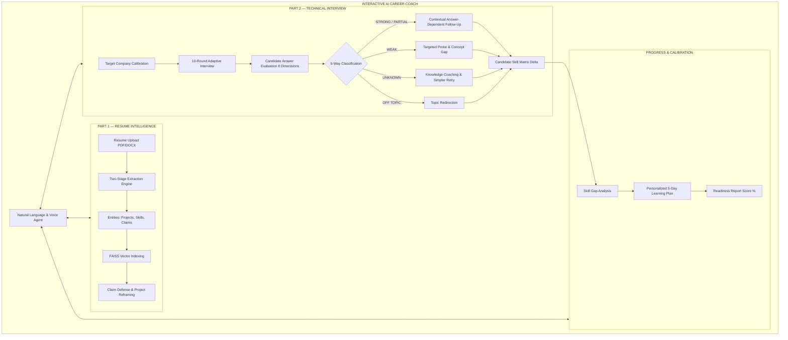

# PREPFORGE AI — INTELLIGENT CAREER & TECHNICAL INTERVIEW OPERATING SYSTEM

> **"Every claim becomes a question. Every answer reveals actual depth. Every weakness becomes a personalized learning path."**

PrepForge AI is a full-stack, enterprise-grade AI Career and Technical Interview Coach. Unlike generic chatbots, PrepForge AI operates as a continuous closed-loop intelligence platform that reads candidate resumes, validates architectural claims, conducts multi-turn adaptive technical interviews, tests live code execution, and calibrates candidate readiness against tier-1 tech hiring bars (e.g. Microsoft, Google, Amazon).

---

## 🌟 Architecture & Core Pillars

The product is built around two primary pillars connected by an interactive AI agent:



---

## 🚀 Key Features

### 1. Resume Intelligence (Part 1)
- **Two-Stage Parsing Engine**: High-fidelity PDF extraction via `PyMuPDF` (`fitz`) and `python-docx` with fallback scanning diagnostics.
- **Entity Extraction**: Automatically identifies projects, tools, databases, latency metrics, and quantifiable impact.
- **Claim Risk Assessment**: Classifies candidate claims (`LOW`, `MEDIUM`, `HIGH` risk) comparing claimed vs demonstrated competency.
- **Project Reframing**: 1-click tailored resume bullets for Software Engineer (Product SDE) vs ML Engineer vs Data Scientist.

### 2. Adaptive Technical Interview Engine (Part 2)
- **Multi-Turn Adaptive Chain**: Sequential question generation where every follow-up question strictly depends on the candidate's previous response.
- **5-Way Answer Classification**:
  - `STRONG` $\rightarrow$ Advances to architectural trade-offs, concurrency hazards, and scale.
  - `PARTIAL` $\rightarrow$ Probes specific missing metrics or implementation gaps.
  - `WEAK` $\rightarrow$ Drills fundamental mechanisms.
  - `UNKNOWN` $\rightarrow$ Zero hallucinated concepts; provides conceptual coaching and a simpler retry question.
  - `OFF_TOPIC` $\rightarrow$ Polite redirection back to the target topic.
- **8-Dimension Real AI Evaluation**: Technical Correctness, Specificity & Metrics, Reasoning & Trade-offs, Evidence Score, Communication, Ownership & Depth, Interviewer Risk, and Actionable Feedback.

### 3. Interactive AI Career Coach Agent
- **Persistent Conversational Drawer**: Always available from any screen with speech-to-text voice recognition.
- **Natural Language Command Dispatch**: Translates user prompts (*"Audit my resume"*, *"Test me on Traffix"*, *"Drill Operating Systems"*, *"Give me a coding problem"*) into live system actions and view navigation.

### 4. Live Coding & CS Drills
- **Live Coding Sandbox**: Multi-language code editor (Python, C++, Java, JavaScript) with Judge0 sandbox execution and time/space complexity analysis ($O(n^2)$ vs $O(n)$).
- **Core CS Fundamentals & System Design**: Targeted drills on OS (Deadlocks, Mutex/Semaphore), DBMS (Indexing, B+ Trees), Networks, and Distributed Systems.
- **Behavioral STAR Evaluator**: Automated scoring on Situation, Task, Action, and Quantified Results.

### 5. Vector RAG & Persistence
- **FAISS Vector Engine**: 384-dimensional dense vector embeddings indexing company rubrics and candidate claims with cosine similarity search.
- **MongoDB & Session Persistence**: Candidate profiles, answer transcripts, and readiness telemetry persisted with fallback disk storage (`backend/data/db_storage/`).

---

## 🛠️ Tech Stack

- **Frontend**: Next.js 14 (App Router), React 18, TypeScript, Tailwind CSS, Lucide Icons, Framer Motion.
- **Backend API**: Python 3.11+, FastAPI, Uvicorn, PyMuPDF, python-docx, Pydantic.
- **AI & RAG**: OpenAI API (`gpt-5.6`), Google Gemini API, FAISS (`faiss-cpu`), Sentence Transformers / OpenAI Embeddings.
- **Execution Engine**: Judge0 Sandbox API.
- **Database**: MongoDB & Local Disk Session Store.

---

## 📋 Prerequisites

- **Node.js**: `v18.x` or `v20.x` or later
- **Python**: `3.10` or `3.11+`
- **npm** or **yarn** / **pnpm**
- **Git**

---

## ⚙️ Environment Configuration

1. Copy `.env.example` to `.env` in the root directory:

```bash
cp .env.example .env
```

2. Fill in your environment variables:

```env
# AI Provider: 'openai' | 'gemini'
AI_PROVIDER=openai

# OpenAI Configuration
OPENAI_API_KEY=your-openai-api-key-here
OPENAI_MODEL=gpt-5.6
OPENAI_EMBEDDING_MODEL=text-embedding-3-small

# Google Gemini Configuration (Optional secondary provider)
GEMINI_API_KEY=your-gemini-api-key-here

# MongoDB Connection
MONGODB_URI=mongodb://localhost:27017
MONGODB_DB_NAME=prepforge_ai

# FAISS Vector Storage
FAISS_INDEX_PATH=./data/faiss_index

# Coding Interview Sandbox (Judge0)
JUDGE0_API_URL=https://judge0-ce.p.rapidapi.com
JUDGE0_API_KEY=your-rapidapi-judge0-key-here

# Demo Mode (Set false for live AI generation)
DEMO_MODE=false
```

---

## 🏃 How to Run the Application

### 1. Start the Backend (FastAPI)

In your terminal / virtual environment:

```bash
# Install Python dependencies
pip install -r backend/requirements.txt

# Start FastAPI server on port 8000
python -m uvicorn backend.main:app --host 127.0.0.1 --port 8000 --reload
```

- Backend runs at: **`http://127.0.0.1:8000`**
- Interactive Swagger API Docs: **`http://127.0.0.1:8000/docs`**
- System Diagnostics: **`http://127.0.0.1:8000/api/system/status`**

### 2. Start the Frontend (Next.js)

In a separate terminal:

```bash
# Install Node dependencies
npm install

# Start Next.js development server on port 3000
npm run dev
```

- Frontend runs at: **`http://localhost:3000`**

---

## 🧪 Running Automated Test Suites

PrepForge AI includes three comprehensive verification suites:

### 1. Multi-Turn Adaptive Interview Chain Test
Verifies 5-way classification, answer-dependent follow-ups, unknown handling, and agent natural language commands:
```bash
python backend/test_adaptive_interview.py
```

### 2. Intelligence Pipeline Verification
Tests PDF parsing, entity extraction, 10-round interview coverage, claim verification, and readiness calculation:
```bash
python backend/test_pipeline.py
```

### 3. Complete Runtime Stack & Integration Audit
Audits OpenAI GPT-5.6, FAISS vector queries, MongoDB persistence, Judge0 sandbox, and resume switching:
```bash
python backend/test_complete_audit.py
```

### 4. TypeScript Typecheck
```bash
npx tsc --noEmit
```

---

## 📁 Project Directory Structure

```
hackspace/
├── backend/
│   ├── data/
│   │   └── db_storage/            # Local persistent session storage
│   ├── services/
│   │   ├── ai_service.py          # OpenAI/Gemini multi-provider AI engine
│   │   ├── db_service.py          # MongoDB & local disk session manager
│   │   ├── rag_service.py         # FAISS vector database & embedding search
│   │   ├── resume_parser.py       # Two-stage PDF/DOCX entity extractor
│   │   ├── interview_engine.py    # Adaptive interview question & rubric engine
│   │   └── code_runner.py         # Judge0 sandbox execution runner
│   ├── main.py                    # FastAPI application routes & endpoints
│   ├── requirements.txt           # Python backend dependencies
│   ├── test_adaptive_interview.py # Multi-turn adaptive chain test suite
│   ├── test_pipeline.py           # Resume intelligence pipeline test suite
│   └── test_complete_audit.py     # 15-point runtime stack audit test suite
├── src/
│   ├── app/
│   │   ├── layout.tsx             # Next.js root layout
│   │   └── page.tsx               # Primary app view switcher & coach drawer
│   ├── components/
│   │   ├── auth/                  # Login & Signup views
│   │   ├── chat/                  # AICoachDrawer (Voice & Text AI Coach)
│   │   ├── dashboard/             # Refactored hero dashboard & command bar
│   │   ├── layout/                # Sidebar, Topbar navigation
│   │   ├── ui/                    # Reusable UI components (Button, Badge, etc.)
│   │   └── views/                 # Core view modules:
│   │       ├── ResumeUploadView.tsx
│   │       ├── ResumeIntelligenceView.tsx
│   │       ├── ProjectIntelligenceView.tsx
│   │       ├── ProjectTransformationView.tsx
│   │       ├── ResumeInterviewView.tsx
│   │       ├── AdaptiveInterviewView.tsx
│   │       ├── CodingChallengeView.tsx
│   │       ├── TechnicalAssessmentView.tsx
│   │       ├── SystemDesignView.tsx
│   │       ├── BehavioralInterviewView.tsx
│   │       ├── SkillIntelligenceView.tsx
│   │       ├── PersonalizedLearningView.tsx
│   │       ├── ReadinessReportView.tsx
│   │       └── SystemStatusView.tsx
│   ├── store/
│   │   ├── PrepForgeContext.tsx   # Global state & API actions
│   │   └── AuthContext.tsx        # Authentication state
│   └── types/
│       └── index.ts               # Core TypeScript definitions & interfaces
├── .env.example                   # Environment template
├── .gitignore                     # Git ignore rules
├── package.json                   # Node.js dependencies & scripts
├── tailwind.config.ts             # Tailwind CSS styling configuration
├── tsconfig.json                  # TypeScript compiler configuration
└── README.md                      # Comprehensive project documentation
```

---

## 🔒 Security & Privacy

- Sensitive API keys (`OPENAI_API_KEY`, `GEMINI_API_KEY`, `JUDGE0_API_KEY`) and `.env` files are ignored via `.gitignore` and never committed to version control.
- Code execution is isolated within sandboxed environments.
- Resume data is processed locally with user consent and encrypted session storage.

---

## 📄 License

MIT License © 2026 PrepForge AI. Built for modern technical hiring preparation.
